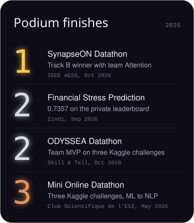

  
  
  
  
  

I’m a computer science student at <strong>ESI, Algeria</strong>, building machine learning models and full-stack applications. 
My work spans reinforcement learning, radar signal classification, predictive modeling and web development.

<strong>Python · PyTorch · LightGBM · Next.js · React · FastAPI</strong> 
Open to internships, research collaborations and freelance projects.

  
  

<h3 align="center">Featured work</h3>

  
  
  
  

I also build language models with <a href="https://github.com/llm-lab-dz">llm-lab-dz</a>: 
<a href="https://github.com/llm-lab-dz/llm-from-scratch">A 98M-parameter GPT from scratch</a> ·
<a href="https://github.com/llm-lab-dz/LLM-FineTune">QLoRA fine-tuning of Qwen2.5-3B</a>

Certificates, live demos and full write-ups are on <a href="https://portfolio-abderahmanes-projects.vercel.app">my portfolio</a>.

